<picture>
  <source media="(prefers-color-scheme: dark)" srcset="assets/header.svg">
  
</picture>

Sou o Kauê, desenvolvedor brasileiro em formação. Faço ferramentas em **Python e JavaScript** para resolver problemas que conheço de perto. Duas perguntas deram origem aos projetos abaixo: *o repasse do delivery bateu com os pedidos?* e *como voltar ao mesmo verso até acertar o tempo?*

**[Abrir meu portfólio](https://ykauttiz.github.io/contratempo/portfolio/)** · Escolha um projeto pela captura da tela e abra **O que testar** para experimentar o primeiro fluxo.

### Rastro Curto

Uma página ficou lenta depois de uma mudança? Compare duas capturas da aba Rede e baixe um boletim para o suporte. No exemplo fictício, duas requisições demoravam pelo menos dois segundos. Na segunda gravação, nenhuma chegou a esse tempo.

[Experimentar o antes e depois](https://ykauttiz.github.io/rastro-curto/) · [Ver o código](https://github.com/ykauttiz/rastro-curto)

### Fecha a Conta

No exemplo fictício, dois depósitos de **R$ 60,00 e R$ 39,80** fecham o lote L01. O pedido 0019 ficou **R$ 1,50 abaixo do previsto**. Abra o pedido para conferir de onde saiu a diferença, até a linha do CSV. O cálculo usa centavos inteiros e os extratos ficam no dispositivo.

[Conferir o exemplo](https://ykauttiz.github.io/fecha-a-conta/) · [Ver o cálculo e o código](https://github.com/ykauttiz/fecha-a-conta) · [Testes](https://github.com/ykauttiz/fecha-a-conta/actions/workflows/conferencia.yml)

### Contratempo

Uma sala de ensaio para áudio e letras sincronizadas. Na faixa **Depois da chuva**, marque A no verso de 0:03 e B no de 0:06. Toque a 0,75× para ensaiar a passagem. O editor permite corrigir o tempo de cada verso e levar a letra para um vídeo em SRT ou WebVTT.

[Entrar na sala de ensaio](https://ykauttiz.github.io/contratempo/) · [Ver o código](https://github.com/ykauttiz/contratempo) · [Testes](https://github.com/ykauttiz/contratempo/actions/workflows/contratempo-tests.yml)

### Outros projetos

- **Porta Fechada** · Compare o acesso a canais e threads do Discord. Veja como um convite, um cargo ou o bloqueio de uma thread muda quem pode responder. [Simulador](https://ykauttiz.github.io/porta-fechada/) · [Código](https://github.com/ykauttiz/porta-fechada)
- **Últimos 50 Metros** · Registre as condições da calçada, da travessia e do embarque de um ponto de ônibus. Consulte o histórico na próxima vistoria. [Abrir a ferramenta](https://ykauttiz.github.io/ultimos-50-metros/) · [Código](https://github.com/ykauttiz/ultimos-50-metros)

[Entregas, testes e próximos passos dos quatro projetos](ROADMAP.md)

Encontrou um caso que a ferramenta trata errado? Abra uma issue no projeto e inclua o resultado esperado e um exemplo fictício que reproduza o problema.

English

I’m Kauê, a Brazilian developer learning by building tools in Python and JavaScript. **Fecha a Conta** reconciles delivery orders and payouts from local CSV files. **Contratempo** lets musicians loop a passage, edit timed lyrics and export subtitles. **Porta Fechada** compares Discord channel permissions, and **Últimos 50 Metros** records bus stop accessibility inspections. [Rastro Curto](https://ykauttiz.github.io/rastro-curto/) compares network recordings and exports only aggregate counts. [Explore the original four demos](https://ykauttiz.github.io/contratempo/portfolio/). The source and automated checks are linked above.

